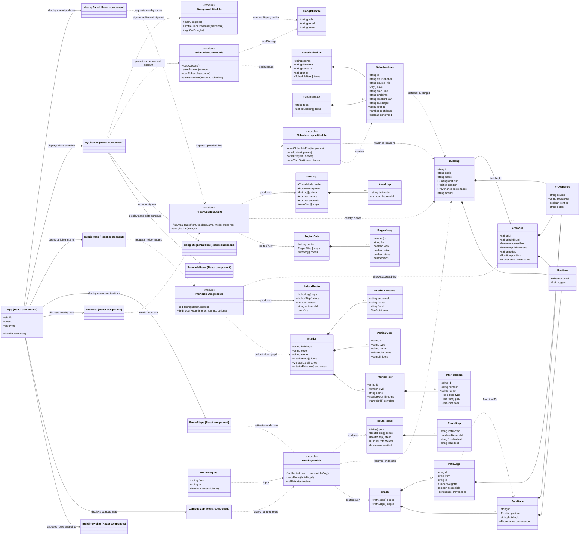
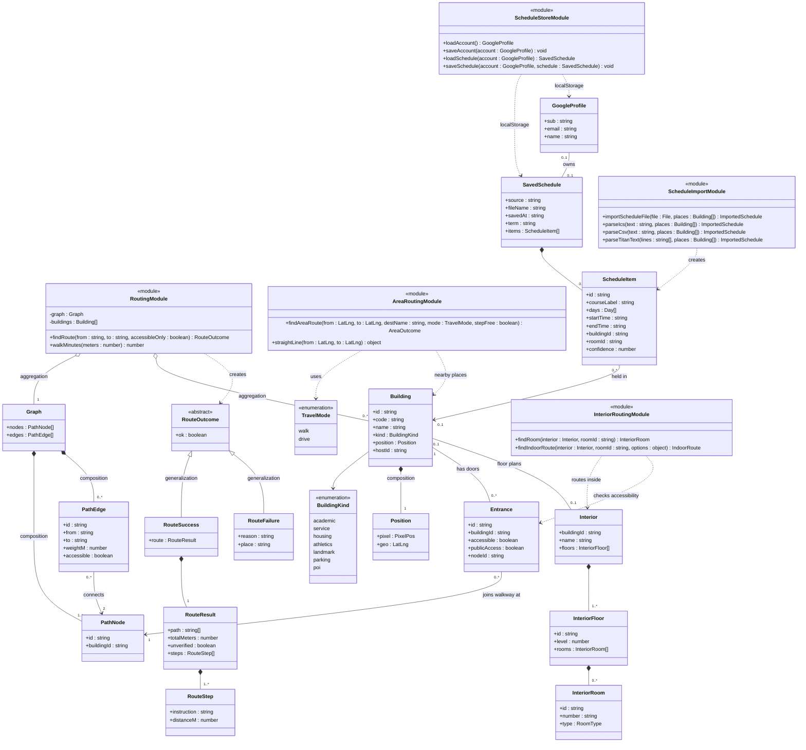
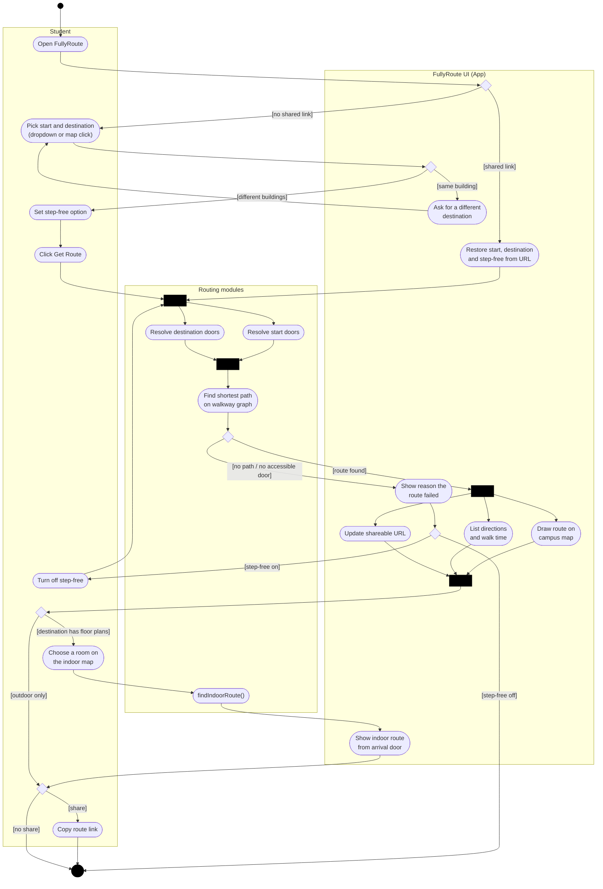
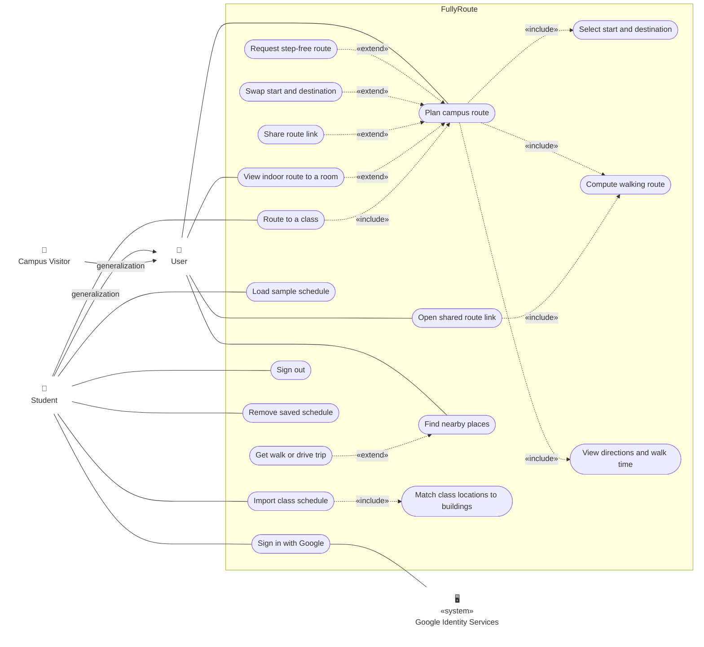

# FullyRoute UML diagrams

These diagrams reflect the application as it is implemented today. The backend
is not implemented yet; routing and schedule data are currently handled in the
browser using imported JSON and local storage.

1. [Architecture class diagram](#1-architecture-class-diagram)
2. [Domain class diagram](#2-domain-class-diagram)
3. [Activity diagram: planning a campus route](#3-activity-diagram-planning-a-campus-route)
4. [Use case diagram](#4-use-case-diagram)

## 1. Architecture class diagram

How the React components, routing/schedule modules and data types connect.

## 2. Domain class diagram

A focused view of the core campus-routing and schedule classes using full
class-diagram notation:

- **Class boxes** have three compartments: name, attributes and operations.
- **Visibility:** `+` public and `-` private (`#` protected and `~` package
  are not needed by these modules).
- **Attributes** are written as `name : type`; **operations** list their
  parameters and return type.
- **Relationships:** composition (filled diamond), aggregation (hollow
  diamond), association (solid line), generalization (hollow triangle) and
  dependency (dashed arrow). Multiplicities such as `1`, `0..1` and `0..*`
  are shown on association ends.

`RouteOutcome` is a TypeScript discriminated union in code
(`{ ok: true, route }` or `{ ok: false, reason, place? }`); it is drawn as an
abstract parent with two subclasses to show that relationship as a
generalization.

## 3. Activity diagram: planning a campus route

The workflow from opening FullyRoute to following a route, split into
**swimlanes** for the student, the React UI and the routing modules. Notation:

- **Initial node** (filled circle) and **final node** (circled dot).
- **Action nodes** (rounded rectangles) for each step.
- **Decision / merge nodes** (diamonds) with **guard conditions** in `[ ]`.
- **Fork / join bars** (thick black bars) for work that happens in parallel.

## 4. Use case diagram

What each actor can do with FullyRoute. Notation:

- **Actors** sit outside the **system boundary** (the FullyRoute box).
  _Student_ and _Campus Visitor_ specialize the general _User_ actor
  (generalization). _Google Identity Services_ is a secondary, external actor.
- **Use cases** are ovals inside the boundary; solid lines are associations
  between actors and the use cases they take part in.
- **«include»** points to behavior that always runs as part of the base use
  case. **«extend»** points from optional behavior back to the use case it
  extends.

All four diagrams are written in Mermaid so they can be reviewed and updated
as the program changes. They render in GitHub and in VS Code's Markdown
preview (with Mermaid support).
